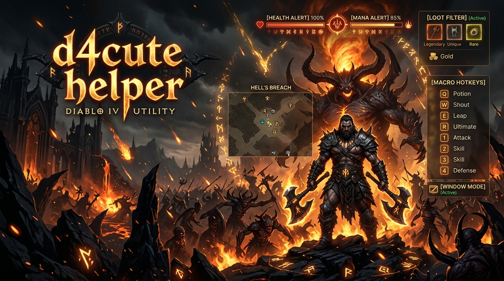
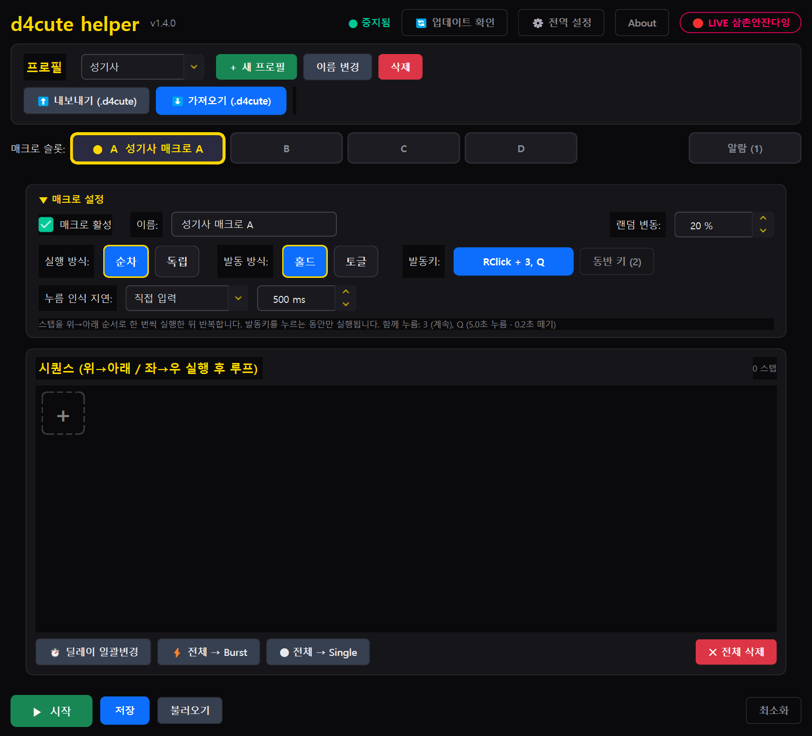
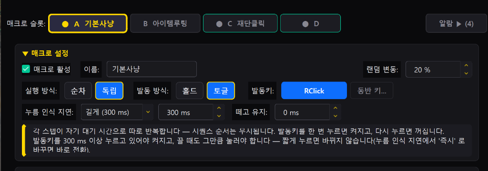
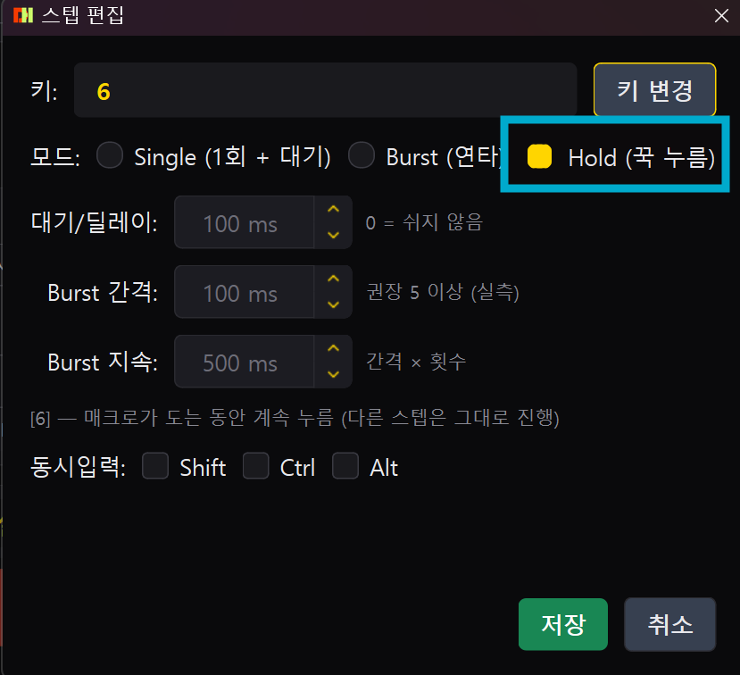
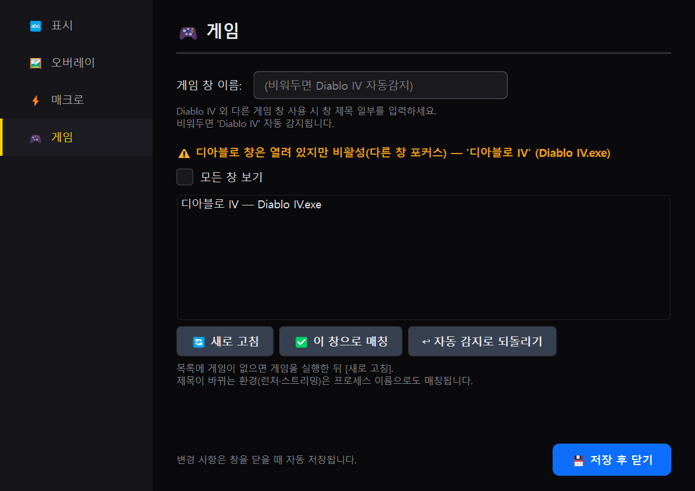
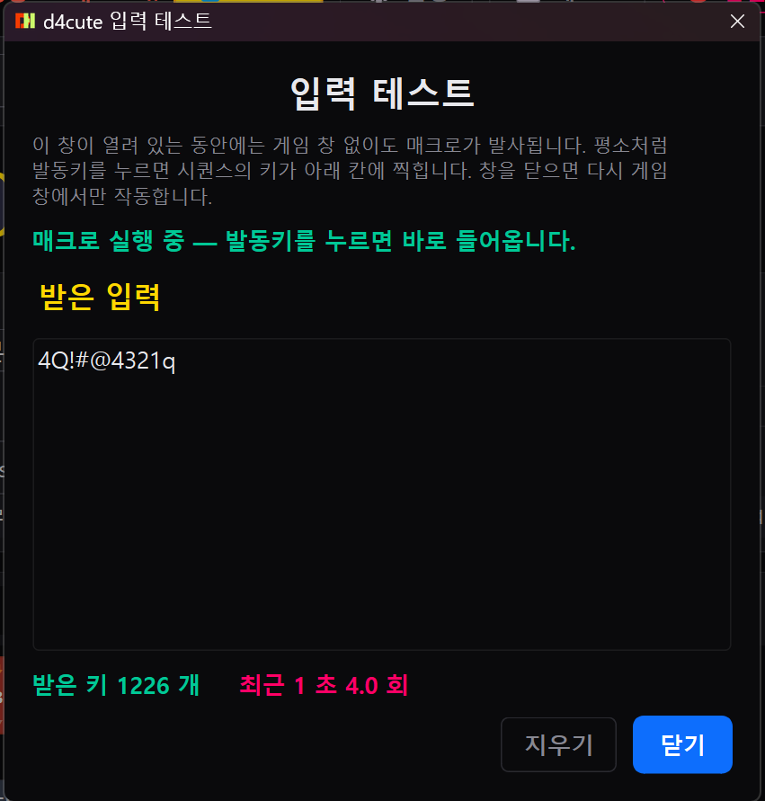
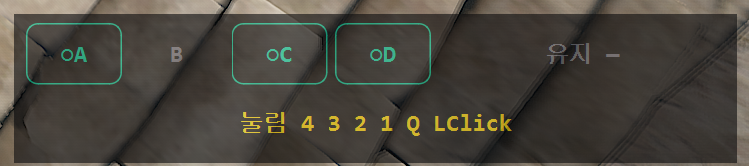
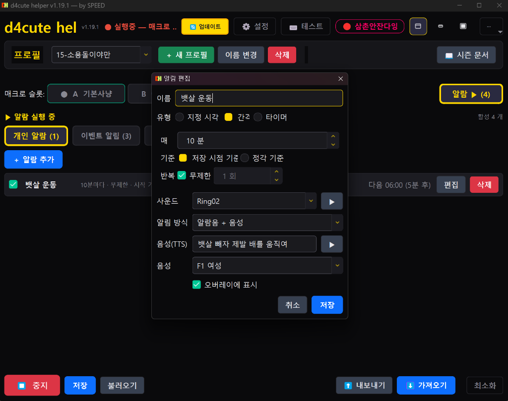
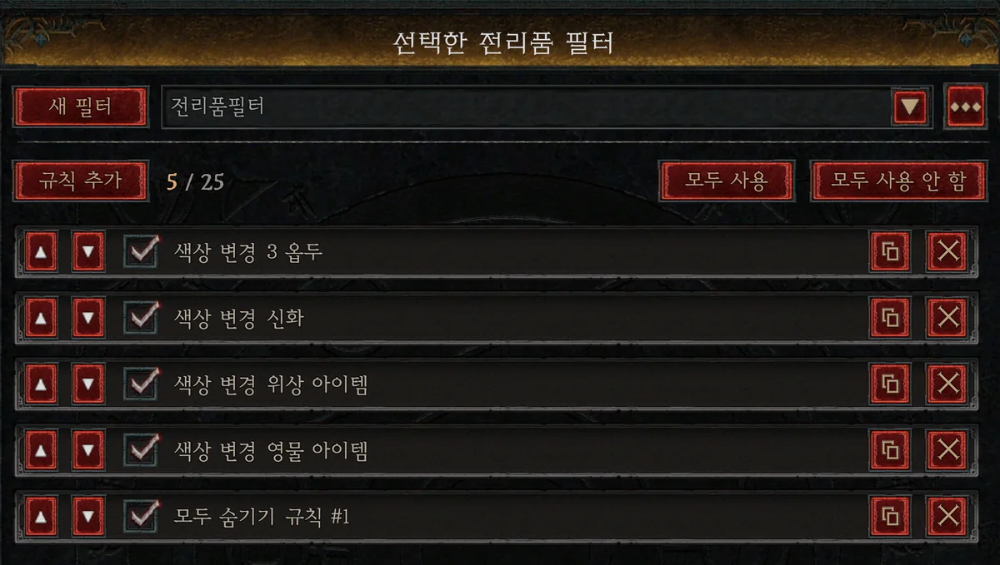
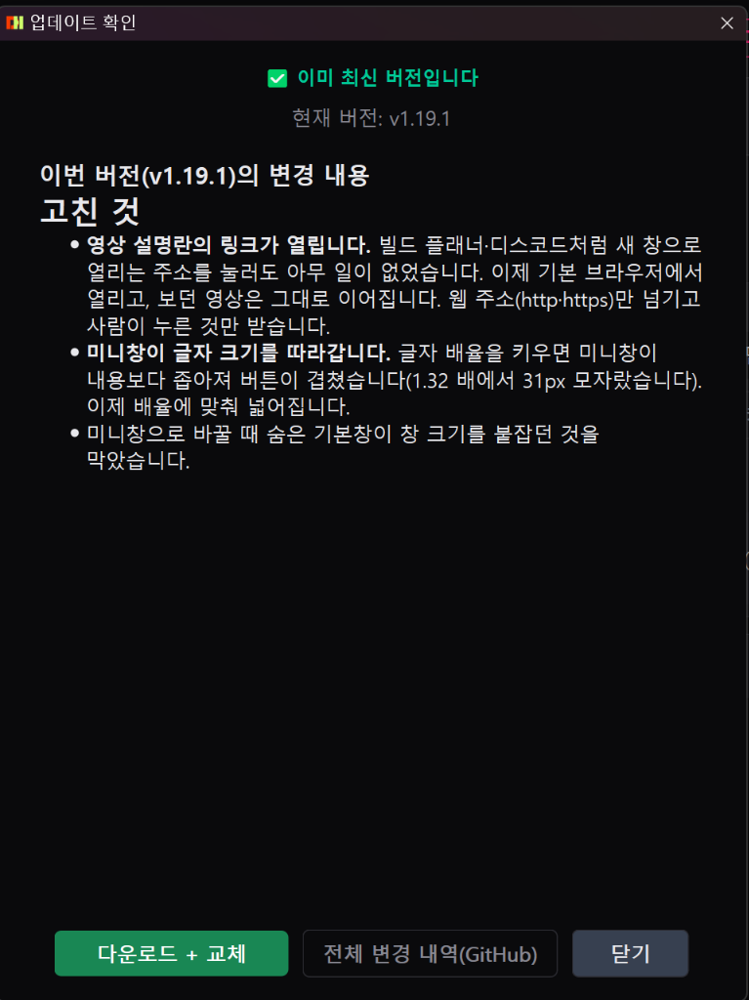

# 디아블로 4 인벤 팁과 노하우 — d4cute helper 사용설명서 & 피드백

> 디아블로4 인벤 커뮤니티 공유용 헬퍼(d4cute helper) 상세 매뉴얼 및 기능 가이드입니다.

---



안녕하세요, 디아블로 4 즐기고 있는 유저입니다.  
시즌마다 나락이나 지옥물결, 군단 돌다 보면 스킬 연타랑 버튼 꾹 누르는 것 때문에 손가락이랑 손목이 너무 뻐근하더라고요.  

기존에 나와 있는 여러 헬퍼 프로그램들도 써봤는데, 특히 **오른쪽 마우스(우클릭)를 발동키로 쓸 때 인벤토리나 창고 열어서 아이템 분해/확인하려고 우클릭하면 스킬이 나가면서 창이 닫혀버리는 현상** 때문에 답답했던 경험이 다들 한 번쯤 있으실 겁니다.  

그래서 "내가 직접 게임하면서 겪는 불편한 점들을 하나씩 다 해결해 보자"는 생각으로 디아4 전용 한국어 헬퍼(**d4cute helper**)를 만들어서 사용해 오고 있습니다.  

클랜원 분들과 함께 쓰면서 계속 다듬다 보니 완성도가 꽤 올라와서, 인벤 유저분들께도 공유해 드리고 실제 게임하시면서 어떤 점이 편한지, 보완할 부분은 없는지 솔직한 의견과 피드백을 받아보고자 정리 글을 올립니다.

---

## 1. 메인 화면 & 매크로 세부 설정 (우클릭 오동작 방지 / 랜덤 변동)



프로그램을 켜면 한눈에 직관적으로 볼 수 있게 한국어로 깔끔하게 구성되어 있습니다.

- **슬롯 A / B / C / D**: 빌드나 상황에 맞춰 4개의 슬롯을 각각 켜고 끌 수 있습니다.
- **순차 vs 독립 실행 방식**:
  - **순차(Sequential)**: 스텝 1 → 2 → 3을 순서대로 위에서 아래로 차례차례 순환합니다.
  - **독립(Independent)**: 시퀀스 순서에 얽매이지 않고, 각 스텝이 자기 대기 시간(딜레이)으로 따로따로 반복합니다. 스킬마다 쿨타임이 제각각일 때 아주 유용합니다.
- **발동 방식 (홀드 vs 토글)**:
  - **홀드(Hold)**: 발동키를 누르고 있는 동안만 매크로 동작 (공격기, 핵심 스킬에 추천)
  - **토글(Toggle)**: 한 번 누르면 On, 다시 누르면 Off (자동 사냥이나 이동 버프에 편리)
- **간편한 키 지정**: 복잡한 코드 찾을 필요 없이 선택창에서 **키보드 키를 직접 누르면 즉시 지정**됩니다. 마우스 우클릭, 휠클릭, 추가 버튼도 마우스 클릭으로 바로 들어갑니다.



> 💡 **핵심 팁 1: 우클릭 인벤토리 닫힘 방지 (누름 인식 지연 설정)**  
> 오른쪽 마우스를 발동키로 쓰실 때는 발동키 설정에서 **[누름 인식 지연]을 '짧게(100ms)' 또는 '길게(300ms)'**로 맞춰두세요. 인벤토리에서 아이템 정리할 때의 '짧은 클릭'은 그대로 게임에만 들어가고, 꾹 누르고 있을 때만 매크로가 돌기 때문에 **아이템 정리 중에 창이 강제로 닫히는 일이 완전히 사라집니다!**

> 💡 **핵심 팁 2: 자연스러운 키 입력을 위한 [랜덤 변동 (%)] 기능**  
> 기계처럼 100ms마다 칼같이 키가 눌리면 부자연스럽고 제재 위험이 생길 수 있습니다.  
> **[랜덤 변동: 20%]**를 주면 입력 딜레이가 80ms~120ms 사이에서 매번 조금씩 불규칙하게 바뀌어, **사람이 직접 손으로 연타하는 것처럼 자연스러운 입력 지터(Jitter)**를 만들어 줍니다. 꼭 켜두시는 것을 권장합니다!

---

## 2. 스텝 편집: 정신집중 스킬을 위한 [Hold (꾹 누름)] 모드



야만용사의 **소용돌이(휠윈드)**나 번개 스킬처럼 **계속 키를 누르고 있어야 하는 정신집중(채널링) 스킬**을 쓰시는 분들을 위한 전용 기능입니다.

- **기존 매크로의 한계**: 토글 매크로로 돌릴 때 일반 단타(Single)나 연타(Burst)로 넣으면 스킬이 뚝뚝 끊겨서 채널링 유지가 안 됩니다.
- **Hold (꾹 누름) 모드**: 토글로 매크로가 켜져 있는 동안 해당 키를 **끝까지 누른 상태로 유지**해주며, 그 와중에도 다른 스텝(외침, 버프기 등)은 백그라운드에서 정상적으로 돌아갑니다!

---

## 3. 시퀀스 편집 편의 기능 & 궁금해하시는 [녹화] 기능 설명

매크로 스텝을 일일이 만들고 초를 맞추기 번거로운 분들을 위해 다양한 편의 기능이 들어있습니다.

- **드래그 이동**: 스텝 순서를 마우스 드래그 앤 드롭으로 손쉽게 위아래로 옮길 수 있습니다.
- **딜레이 일괄 변경**: 모든 스텝의 대기 시간을 한 번에 원하는 ms(예: 100ms)로 일괄 수정합니다.
- **전체 → Burst / 전체 → Single**: 등록된 모든 키를 한 번의 클릭으로 '연타 모드' 또는 '1회 단타 모드'로 일괄 변환합니다.
- **🎬 [녹화(Record)] 기능이란?**  
  매크로 키와 딜레이를 하나하나 손으로 입력할 필요 없이, **[녹화] 버튼을 누른 상태에서 실제 게임하듯 키보드/마우스를 자연스럽게 누르면** 누른 키와 누르고 있던 시간, 키 간격 딜레이를 실시간으로 측정해서 **그대로 시퀀스 스텝으로 자동 생성해 주는 기능**입니다! 손에 익은 나만의 딜 사이클을 10초 만에 완벽 복사할 수 있습니다.

---

## 4. 보조 스킬 유지를 위한 '동반 키' 기능


디아4에서는 주력 딜 스킬을 누르면서 쿨마다 외침, 보호막, 방어기 같은 스킬들을 같이 돌려야 하는 경우가 많습니다.

이럴 때 발동키 옆 **[동반 키...]** 버튼을 누르고 함께 유지할 키를 넣어두면:
- 우클릭으로 공격하는 동안 `3`번, `Q`번 같은 보조 스킬이 지정한 초(예: 5초 누름 / 0.2초 뗌) 간격으로 자연스럽게 같이 돌아갑니다.
- 발동키를 떼거나 정지하면 눌려 있던 동반 키도 즉시 안전하게 풀립니다.

---

## 5. 인벤토리 · 지도 열림 시 자동 정지 (안전 대기 키)



토글 모드로 매크로를 켜둔 상태에서 갑자기 마을에 가거나 인벤토리(I), 지도(M), 옵션(ESC)을 열었을 때 스킬이 계속 나가서 곤란했던 적 있으실 텐데요.

헬퍼 설정의 **[대기 키]**에 `I, M, ESC`가 기본 등록되어 있어, 해당 키를 눌러 창을 여는 순간 **매크로가 즉시 일시정지**되며, 창을 닫으면 알아서 원래대로 복귀합니다.

---

## 6. 안전한 사전 검증! [입력 테스트] & [인게임 오버레이]





- **입력 테스트**: 매크로 설정 후 바로 사냥터 갔다가 키가 꼬여서 죽는 일이 없도록, 상단 **[테스트]** 버튼을 누르면 가상 테스트 창이 뜹니다. 게임 창이 없어도 발동키를 누르면 키가 정상적으로 찍히는지, 초당 몇 타로 발사되는지 눈으로 바로 확인할 수 있습니다.
- **인게임 오버레이**: 게임 화면 위에 반투명으로 현재 활성화된 슬롯(A~D)과 실시간으로 눌리고 있는 키 목록을 띄워주어, 내 매크로가 지금 정상 동작 중인지 한눈에 알 수 있습니다.

---

## 7. 알람 설정 (월드보스 · 지옥물결 · 군단 / 비약 · TTS 음성 알림)



파밍에 집중하다 보면 중요한 이벤트나 비약 갱신 시간을 놓치기 일쑤입니다.

- **이벤트 알람 (3종)**: **야외 우두머리(월드보스), 지옥물결, 군단** 시작 시간을 헬퍼가 실시간으로 추적하여 시작 전/정각에 알려줍니다.
- **개인 맞춤 알람**: 30분 비약 버프, 향 갱신 알림은 물론이고, 장시간 파밍 시 **"뱃살 운동 (10분마다)", "스트레칭 하세요"** 같은 건강 관리 타이머를 자유롭게 등록할 수 있습니다.
- **알림 방식**: 깔끔한 효과음뿐만 아니라 **TTS 한국어 음성(여성/남성)**으로 직접 읽어주며, 화면 오버레이에 팝업 배너로도 표시됩니다.

---

## 8. 프로필 관리 & 클릭 한 번으로 세팅 공유 (내보내기 / 가져오기)

빌드가 바뀌거나 다른 직업을 키울 때마다 매크로를 새로 짤 필요가 없습니다.

- **프로필 무제한 생성**: `[+ 새 프로필]` 버튼으로 '소용돌이야만', '쳐부수기드루', '연발도적' 등 직업별 세팅을 저장하고 드롭다운으로 즉시 전환할 수 있습니다.
- **내보내기 / 가져오기**: 내가 완성한 매크로와 알람 세팅을 파일로 **[내보내기]**해서 클랜원에게 공유할 수 있고, 다른 고수 유저가 올린 설정 파일은 **[가져오기]** 한 번으로 내 프로그램에 그대로 불러올 수 있습니다.

---

## 9. 게임 도중 웹 서핑 끝! [시즌 문서] 내장 뷰어

헬퍼 오른쪽 상단 **[시즌 문서]** 버튼을 누르면, 알트탭 해서 웹 브라우저를 찾을 필요 없이 헬퍼 안에서 바로 디아4 핵심 정보를 확인할 수 있습니다.

- 선조 고유 아이템 리스트 및 드랍처
- 보스별 소환 재료 정리
- 대악마 가시 파밍 및 시즌 아이템 제작 공식 모음

---

## 10. 바닥 정리 끝판왕! '전리품 필터' 공유



파밍 효율을 극대화하기 위해 게임 내 전리품 필터 설정 코드도 함께 넣어두었습니다.  
바닥에 일반 전설들이 산더미처럼 쌓여서 중요한 템을 놓치지 않도록, **3옵두 · 신화 · 위상 · 영물 아이템만 눈에 띄는 색상으로 표시하고 나머지는 깔끔하게 숨기는 규칙(5개)**입니다.

**[인게임 전리품 필터 복사용 코드]**
```
ChkKCDMg7Ji165GQEAId/wBq/yIECAYgAygBCiEKBuyLoO2ZlBACHccS//8iBAgBICAiCAgAIKAGKIQHKAEKIQoQ7JyE7IOBIOyVhOydtO2FnBACHSIi6P8iBAgDMAEoAQovChDsmIHrrLwg7JWE7J207YWcEAIdGebp/yIMCAUVBe0iABWAfiMAIgQIASBYKAEKDxADHQAA//8iBAgBIF8oARIP7KCE66as7ZKI7ZWE7YSwGAcgCQ==
```
※ 인게임 설정 → 전리품 필터 창에서 **필터 이름 칸 오른쪽 [⋯] → [가져오기]** 누르고 붙여넣으신 후 '모두 사용'으로 켜시면 바로 적용됩니다.

---

## 11. 화면 안 가리는 '미니창 모드' & 항상 위(Always On Top)


듀얼 모니터가 아니거나 모니터 한 대로 플레이하시는 분들을 위해 **미니창(Compact) 전환 모드**와 **항상 위(Always On Top) 고정** 기능을 지원합니다.  
불필요한 버튼과 설정 영역은 싹 숨기고, 현재 슬롯 상태와 On/Off 여부만 미니 위젯처럼 게임 화면 모서리에 띄워놓고 가볍게 쓰실 수 있습니다.

---

## 12. 원클릭 [자동 업데이트] 지원 (v1.19.1 최신)



프로그램을 쓰다가 새 버전이 나오면 헬퍼 상단에 노란색 **[업데이트]** 버튼이 뜹니다.  
귀찮게 사이트에 다시 들어가서 새로 다운받고 압축 풀 필요 없이, 창에서 **[다운로드 + 교체]** 버튼만 누르면 헬퍼가 알아서 최신 파일로 자동 교체하고 재실행됩니다. 변경 내역과 패치 노트도 창 안에서 바로 읽어보실 수 있습니다.

---

## 13. 다운로드 및 참고 링크

개인 취미로 개발한 프로그램이라 별도의 회원가입이나 광고, 결제 요소 없이 완전 무료입니다. 관리자 권한도 요구하지 않으며, 윈도우 키보드/마우스 이벤트 후킹 방식으로 가볍게 동작합니다.

| 구분 | 링크 및 안내 |
|---|---|
| **설치 버전 (권장)** | [d4cute_helper_setup.exe (원클릭 자동 업데이트 지원)](https://github.com/nimto/d4help/releases/latest/download/d4cute_helper_setup.exe) |
| **무설치 포터블 버전** | [d4cute_helper.exe (다운로드 후 바로 실행)](https://github.com/nimto/d4help/releases/latest/download/d4cute_helper.exe) |
| **상세 사용법 영상** | [https://youtu.be/Ff7MBqD4WaI (유튜브 3분 가이드)](https://youtu.be/Ff7MBqD4WaI) |
| **삼촌안잔다잉 유튜브 채널** | [https://www.youtube.com/@삼촌안잔다잉 (디아4 라이브 & 공략 영상)](https://www.youtube.com/@삼촌안잔다잉) |
| **공식 문서 & 깃허브** | [https://da.gd/d4help (전체 변경 내역 및 Q&A)](https://da.gd/d4help) |

> ⚠️ **처음 실행 시 SmartScreen 안내**  
> 개인 개발자가 무료 배포하는 파일이라 윈도우에서 '알 수 없는 게시자' 경고(SmartScreen)가 뜰 수 있습니다. **[추가 정보] → [실행]**을 누르시면 정상 실행됩니다.

---

## 마치며 (솔직한 피드백 부탁드립니다!)

제가 직접 플레이하면서 답답했던 부분들을 긁어모아 만든 프로그램이라, 다른 직업이나 다른 빌드를 하시는 분들께는 또 어떤 기능이 필요할지 궁금합니다.  
직접 써보시고 **"이런 키 조합이나 세팅이 있으면 좋겠다", "이 부분은 조금 버벅인다", "이 기능 추가되면 더 편하겠다"** 하는 의견이 있으시면 댓글로 가감 없이 편하게 피드백 남겨주세요! 확인하고 계속해서 업데이트하겠습니다.  

> 🎬 **개발자 삼촌의 쪼꼬만 부탁... (ฅ^•ﻌ•^ฅ) 💖**  
> 디아블로4 라이브 방송이랑 알짜 공략 영상들을 올리고 있는 유튜브 **[삼촌안잔다잉]** 채널도 함께 운영하고 있습니다!  
> 밤새도록 헬퍼 코딩하고 나락 파밍하느라 삼촌은 오늘도 잠을 안 잡니다... 🌙✨  
> 영상 보시고 **구독과 좋아요, 알림 설정** 한 번씩 꾹꾹 눌러주시면 다음 업데이트 개발에 어마어마한 비타민과 호랑이 힘이 됩니다! 🐯🍀  
> ▶ **[유튜브 삼촌안잔다잉 구경 가기 (라이브 소통 환영!)](https://www.youtube.com/@삼촌안잔다잉)**  

읽어주셔서 감사드리고, 다들 득템하시고 손목 편안한 성역 생활 되시길 바랍니다. 🍀
