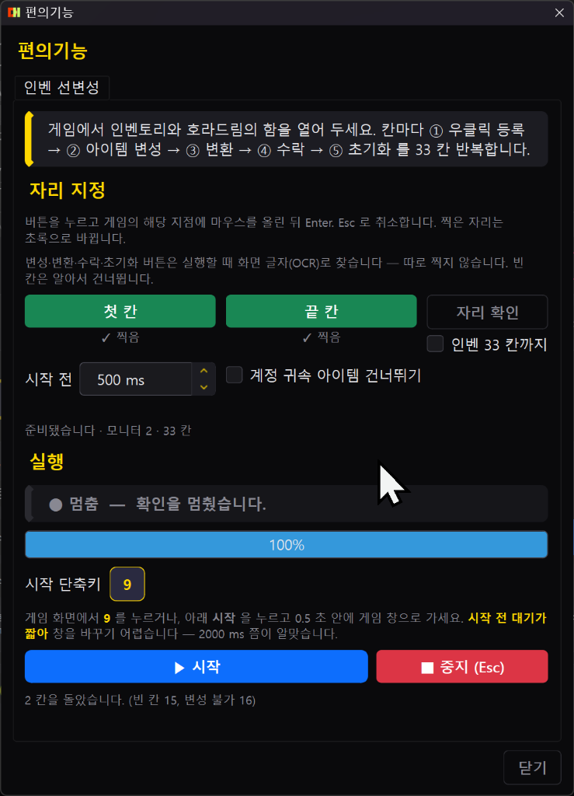
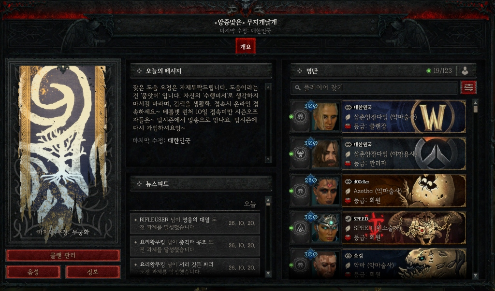

# 디아블로 4 인벤 팁과 노하우 — d4cute helper 사용설명서 & 피드백

> 디아블로4 인벤 커뮤니티 공유용 헬퍼(d4cute helper) 상세 매뉴얼 및 기능 가이드입니다.

---


안녕하세요, 디아블로 4 즐기고 있는 유저입니다.  
시즌마다 나락이나 지옥물결, 군단 돌다 보면 스킬 연타랑 버튼 꾹 누르는 것 때문에 손가락이랑 손목이 너무 뻐근하더라고요.  

기존에 나와 있는 여러 헬퍼 프로그램들도 써봤는데, 특히 **오른쪽 마우스(우클릭)를 발동키로 쓸 때 인벤토리나 창고 열어서 아이템 분해/확인하려고 우클릭하면 스킬이 나가면서 창이 닫혀버리는 현상** 때문에 답답했던 경험이 다들 한 번쯤 있으실 겁니다.  

그래서 "내가 직접 게임하면서 겪는 불편한 점들을 하나씩 다 해결해 보자"는 생각으로 디아4 전용 한국어 헬퍼(**d4cute helper**)를 만들어서 사용해 오고 있습니다.  

클랜원 분들과 함께 쓰면서 계속 다듬다 보니 완성도가 꽤 올라와서, 인벤 유저분들께도 공유해 드리고 실제 게임하시면서 어떤 점이 편한지, 보완할 부분은 없는지 솔직한 의견과 피드백을 받아보고자 상세 사용 설명서 겸 정리 글을 올립니다.

---

## 1. 메인 화면 & 매크로 슬롯 (순차 vs 독립 / 홀드 vs 토글)


프로그램을 켜면 한눈에 직관적으로 볼 수 있게 한국어로 깔끔하게 구성되어 있습니다.

- **슬롯 A · B · C · D**: 슬롯마다 이름과 켜기/끄기, 실행 방식, 발동 방식을 각각 독립적으로 정할 수 있습니다.
- **실행 방식 (순차 vs 독립)**:
  - **순차(Sequential)**: 등록된 스텝(1 → 2 → 3)을 위에서 아래로 차례차례 순환 반복합니다. 딜 사이클 연계기에 적합합니다.
  - **독립(Independent)**: 스텝 순서에 얽매이지 않고, 각 스텝이 자기 딜레이(대기 시간)로 따로따로 독립 반복합니다. 스킬마다 쿨타임이 제각각일 때 아주 유용합니다.
- **발동 방식 (홀드 vs 토글)**:
  - **홀드(Hold)**: 발동키를 **누르고 있는 동안만** 매크로가 동작합니다. 발동키를 떼면 즉시 멈추므로 주 공격기나 정예 조우 시 집중 딜에 최적입니다.
  - **토글(Toggle)**: 발동키를 한 번 누르면 켜지고(On), 다시 누르면 꺼집니다(Off). 이동기나 장시간 자동 사냥에 편리합니다.
- **간편한 발동키·스텝 키 지정 (직접 누름 방식)**:
  - 복잡한 가상 키 코드 목록을 찾을 필요 없이, 키 선택창이 열렸을 때 **키보드로 원하는 키를 직접 누르면 즉시 지정**됩니다.
  - `Ctrl`, `Shift`, `Alt`를 누른 채로 키를 누르면 조합키 그대로 한 번에 들어갑니다. (`Tab`, `Space`, `Enter`, 방향키 등 모두 지원)
  - 마우스 오른쪽(우클릭), 휠클릭(가운데), 측면 X1/X2 버튼은 상단 미리보기 칸을 해당 버튼으로 클릭하면 바로 바인딩됩니다.
  - 지정을 취소하고 싶을 때는 **`Esc`를 누르면 즉시 취소**됩니다. (만약 `Esc` 키 자체를 매크로 키로 쓰고 싶으실 때는 창 하단의 [Esc 선택] 버튼 클릭 후 [확인])
  - 같은 본 키를 쓰는 매크로(예: `A`와 `Shift+A`)가 함께 있으면, `Shift`를 누른 동안에는 기본 `A` 매크로가 오발동하지 않도록 스마트하게 방지합니다.

---

## 2. 오른쪽 마우스(우클릭) 오동작 완벽 방지 & 세부 옵션


오른쪽 마우스(RClick)는 게임 안에서 **공격 스킬**뿐만 아니라 **아이템 착용 · 창고 넣기 · 대장장이 분해** 같은 인터페이스 조작에도 똑같이 쓰입니다.  
만약 발동키가 오른쪽 마우스인데 **누름 인식 지연이 '즉시(0 ms)'**라면, 인벤토리에서 아이템을 우클릭하는 그 짧은 찰나(0.05초)에도 매크로가 발동되어 스킬 키가 눌리고 **열려 있던 인벤토리나 창고 창이 강제로 닫혀 버립니다.**

이를 완벽하게 해결하기 위해 **[누름 인식 지연]** 시스템이 들어가 있습니다:

| 설정값 | 실제 동작 및 효과 |
|---|---|
| **즉시 (0 ms)** | 마우스를 누르자마자 0초 만에 매크로 시작 (인벤토리 우클릭 시에도 스킬이 나가며 창 닫힘) |
| **짧게 (100 ms) - 권장★** | 0.1초 이상 꾹 누르고 있어야만 매크로 발동. 보통의 아이템 정리 우클릭은 0.1초보다 짧으므로 **창이 닫히지 않고 정상 정리 가능!** |
| **길게 (300 ms)** | 0.3초 이상 누르고 있을 때만 시작. 손가락 힘이 세거나 클릭이 다소 긴 분들을 위해 더 확실한 구분 보장. |
| **직접 입력** | 50ms ~ 3000ms 사이에서 내 손가락 습관에 맞춰 1ms 단위로 미세 조절 가능. |

> 💡 **실전 세팅 가이드:**  
> 오른쪽 마우스를 발동키로 쓰는 홀드 방식이라면 먼저 **[짧게 (100 ms)]**로 시작해 보세요. 짧게 톡 누르는 우클릭은 인벤토리 아이템에만 전달되고, 몬스터를 향해 마우스를 꾹 누를 때만 매크로가 돌아갑니다.  
> 지연이 걸려 있을 때는 발동키 버튼에 `· 0.1s 이상` 처럼 안내가 표시됩니다. (토글 방식에는 지연이 적용되지 않으며, 시퀀스에 포함된 키를 발동키로 써도 매크로 자체 키 입력에 반응하지 않으므로 무한루프 없이 안전합니다.)

> 💡 **지연 재시작 & 떼고 유지 (Hold 모드 고급 제어):**  
> • **지연 재시작**: 지연 대기 시간(100ms) 중에 발동키를 뗐다가 다시 누르면 지연 카운트를 처음부터 다시 셉니다.  
> • **떼고 유지 (0~3000 ms)**: 무빙을 치거나 몬스터 타겟을 바꾸느라 발동키(우클릭)를 아주 잠깐 뗐을 때, 매크로가 뚝 끊기지 않고 설정한 시간(예: 300ms) 동안 공격 흐름을 유지해 줍니다. 그 시간 안에 다시 누르면 스킬이 부드럽게 이어집니다! (0ms = 떼는 즉시 중지)

> 💡 **인간적인 입력을 위한 [랜덤 변동 (%)] 기능:**  
> 매크로가 100ms마다 한 치의 오차도 없이 기계처럼 정확하게 입력되면 시스템 감지 위험이나 부자연스러움이 생길 수 있습니다.  
> **[랜덤 변동: 15~20%]**를 설정해 두면 100ms 딜레이가 80ms~120ms 사이에서 매 입력마다 불규칙하게 바뀌어, **사람이 직접 손가락으로 연타하는 것과 동일한 자연스러운 입력 지터(Jitter)**를 만들어 줍니다.

---

## 3. 스텝 편집: 정신집중 스킬을 위한 [Hold (꾹 누름)] 모드


야만용사의 **소용돌이(휠윈드)**나 강령술사의 부패, 원소술사의 번개 줄기처럼 **키를 떼지 않고 계속 누르고 있어야 하는 채널링(정신집중) 스킬**을 위한 기능입니다.

- **Single (단타)**: 키를 1회 누르고 설정한 ms 동안 대기합니다. (일반 쿨타임 스킬에 사용)
- **Burst (연타)**: 지정한 간격(ms)으로 지속 시간(ms) 동안 초고속 연타를 날린 뒤 휴식합니다. 타임라인 그래프로 몇 번 타격되는지 눈으로 바로 볼 수 있습니다.
- **Hold (꾹 누름)**: 토글 매크로가 켜져 있는 동안 해당 키를 **하드웨어적으로 끝까지 누른 상태로 유지**합니다.  
  기존 헬퍼들은 채널링 스킬도 연타로 쪼개서 넣다 보니 스킬 시전이 뚝뚝 끊겼지만, **Hold 모드를 쓰면 소용돌이를 멈춤 없이 쾌속으로 돌면서 다른 스텝의 외침이나 방어 버프가 정상적으로 같이 시전**됩니다!

---

## 4. 시퀀스 편의 기능 & [녹화(Record)] 기능 상세 설명

매크로 스텝을 일일이 만들고 초를 맞추기 번거로운 분들을 위해 다양한 편집 도구가 포함되어 있습니다.

- **마우스 드래그 이동**: 스텝 카드를 마우스로 잡고 끌어서 위아래 순서를 자유롭게 바꿉니다.
- **딜레이 일괄 변경**: 등록된 모든 스텝의 대기 시간을 한 번에 원하는 ms(예: 100ms)로 일괄 변경합니다.
- **전체 → Burst / 전체 → Single**: 클릭 한 번으로 모든 등록 키를 '연타 모드' 또는 '1회 단타 모드'로 일괄 변환합니다.
- **🎬 [녹화(Record)] 기능이란?**  
  키와 딜레이를 계산해서 숫자로 타이핑할 필요 없이, 실제 인게임에서 사냥하듯 플레이하면 그대로 매크로로 만들어주는 기능입니다.
  1. 헬퍼에서 **[● 녹화]** 버튼을 클릭합니다.
  2. 디아블로 4 게임 화면으로 넘어가면 화면 중앙에 `녹화 시작까지 5… 4… 3…` 카운트다운이 뜹니다. (카운트 중 `Esc`를 누르면 즉시 취소)
  3. 카운트가 끝나면 실제 전투하듯 스킬 키와 마우스 버튼을 자연스럽게 누르세요. **누른 키, 누르고 있던 시간, 키와 키 사이의 간격(딜레이)**을 실시간으로 캡처합니다.
  4. 사냥 사이클이 끝나면 **`Esc`를 눌러 즉시 녹화를 종료**합니다.
  5. 헬퍼 창에 **[기존 스텝 뒤에 추가 / 기존 스텝 바꾸기]** 선택창이 뜨며, 내가 방금 손으로 친 딜 사이클이 시퀀스 카드로 100% 자동 생성됩니다!  
  *(※ 게임 창이 활성화되어 있을 때의 실제 입력만 기록되며, 매크로가 자체 생성하는 키는 녹화되지 않으므로 안심하고 쓰실 수 있습니다.)*

---

## 5. 보조 버프 유지를 위한 [동반 키] 시스템


디아4에서는 주력 공격 스킬을 누르면서 쿨타임마다 외침, 보호막, 진노 같은 보조 버프를 지속적으로 유지해야 하는 경우가 많습니다.  
발동키 옆 **[동반 키…]** 버튼을 누르면 최대 6개까지 보조 키를 등록할 수 있습니다:

- **동작 원리**: 매크로가 활성인 동안(홀드 = 발동키 누르는 동안 / 토글 = 켜진 동안) 지정한 보조 키들을 **누른 상태로 유지**하고, 발동키를 떼거나 매크로를 끄면 **같이 뗍니다**. (예: 마우스 우클릭 누르는 동안 `3`번, `Q`번도 함께 유지)
- **키별 누름 초 · 떼기 초 주기 제어**:
  - 누름 `0초` = 매크로가 켜져 있는 동안 계속 누르고 있음 (기본값)
  - `5.0초 누름 · 0.2초 뗌` = 5초 동안 누름 유지 → 0.2초 살짝 뗌 → 다시 5초 누름 반복!
- **스마트 복원 & 안전장치**: 시퀀스 스텝이 동반 키와 겹치는 키를 누를 경우, 스텝 입력이 끝난 뒤 자동으로 동반 키를 다시 누른 상태로 복원해 줍니다. `Ctrl+F12` 중지, 알트탭, 프로그램 종료 시에도 눌려 있던 키가 컴퓨터에 남지 않고 깨끗하게 풀립니다.

---

## 6. 완벽한 게임 안전장치: [대기 키] & [게임 창 스마트 감지]


- **대기 키 (토글 자동 정지 키)**:  
  토글 모드로 매크로를 켜둔 상태에서 채팅(`Enter`), 지도(`Tab / M`), 마을 포탈(`T`), 인벤토리(`I`)를 여는 순간 **매크로가 즉시 일시정지(대기)** 상태로 들어갑니다.  
  창을 닫기 위해 같은 키나 `Esc`, 또는 발동키를 누르면 매크로가 알아서 사냥 상태로 **자동 재개**됩니다. (게임 창이 비활성화되어 바탕화면으로 가도 즉시 대기합니다.)
- **게임 창 프로세스 매칭**:  
  매크로는 **오직 디아블로 4 창이 화면 맨 앞에 활성화되어 있을 때만 동작**합니다. 런처나 스트리밍 등으로 게임 창 제목이 달라도 프로세스(`Diablo IV.exe`)를 기준으로 자동 매칭되며, [전역 설정 → 게임]에서 현재 열린 창을 직접 지정할 수도 있습니다.

---

## 7. 안전한 사전 검증! [입력 테스트] & [인게임 HUD 오버레이]


- **가상 입력 테스트**: 매크로 설정 후 고단 나락에 바로 들어갔다가 키가 꼬여서 사망하는 일이 없도록, 상단 **[테스트]** 버튼을 누르면 가상 테스트 모드가 열립니다. 게임 창이 없어도 발동키를 누르면 키가 정상적으로 나가는지, 초당 몇 타로 발사되는지 그래프와 숫자로 눈으로 직접 확인할 수 있습니다.
- **인게임 HUD 오버레이 (핫키: Ctrl+F11)**:  
  게임 화면 위에 반투명으로 `▶ 실행 [A,B] · 시전 [A] +3,Q` 처럼 켜진 매크로와 지금 눌리고 있는 스킬 키를 실시간으로 보여줍니다. 대기 상태일 때는 `⏸ 대기중 (채팅 · 지도)` 문구가 깜빡입니다.  
  듀얼 모니터를 쓰시는 분들을 위해 **표시할 모니터 선택**, 위치(좌/중/우 × 상/중/하), 투명도, 크기 조절을 완벽하게 지원합니다. (전역 매크로 시작/중지 핫키는 `Ctrl+F12` 입니다.)

---

## 8. 알람 탭: 이벤트 알림 · 개인 알람 · 화면 배너 · TTS 한국어 음성


파밍에 집중하다 보면 월드보스나 지옥물결, 비약 버프 시간을 놓치는 경우가 많습니다. 알람 탭에 강력한 시간 관리 기능들이 모두 들어있습니다.

- **이벤트 알림 (3종 자동 추적)**:
  - **야외 우두머리 (월드보스)**: API 연동으로 5분마다 다음 등장 시각을 자동 조회하며, 네트워크가 끊겨도 3.5시간 주기 알고리즘으로 자동 예측합니다.
  - **지옥물결**: 매시 정각 규칙을 완벽하게 추적합니다.
  - **군단**: 기준점 설정 후 25분 주기를 실시간 계산합니다.
  - 각 이벤트마다 **[5분 전 / 3분 전 / 1분 전 / 정각 시작]** 칩 버튼을 원하는 대로 켜고 끌 수 있습니다.
- **개인 맞춤 알람 (3종)**:
  - **지정 시각 알람**: 특정 시각(요일 반복 또는 1회) 알림
  - **간격 알람**: N분마다 반복 (30분 비약 버프, 향 갱신 알림)
  - **타이머 알람**: N분 뒤 1회 알림 (장시간 플레이 시 건강을 위한 **"스트레칭 하세요", "물 마시기"** 등)
- **화면 배너 알림**:  
  헤드셋을 벗고 있거나 소리를 꺼두었을 때도 알 수 있도록, 게임 화면 중앙 캐릭터 머리 위에 **큰 글씨로 반투명 배너(위치/글자 크기/표시 시간 조절 가능)**가 뜹니다. 게임 클릭을 전혀 방해하지 않고 통과(Click-through)시킵니다.
- **🔊 온디바이스 AI 음성 안내 (TTS - Supertonic 3)**:  
  단순한 삑삑 소리뿐만 아니라 **자연스러운 한국어 음성(남성 M1~M5 / 여성 F1~F5)**으로 "야외 우두머리 5분 전입니다", "비약 갱신 시간입니다" 하고 직접 읽어줍니다.  
  오프라인 온디바이스 모델이라 인터넷 연결 없이도 가볍고 빠르게 발화됩니다. (알람 탭 → [기본 사운드 · 음성]에서 설정)
- **💡 알람 시작 안내**: 앱 실행 시 알람은 안전을 위해 중지 상태입니다. 메인 화면의 **[▶ 시작]**(또는 Ctrl+F12)을 누르면 매크로와 알람이 함께 시작됩니다. 매크로 없이 알람만 쓰고 싶을 때는 슬롯이 꺼진 상태에서 [▶ 시작]을 누르시면 됩니다.

---

## 9. 프로필 관리 & 원클릭 세팅 공유 (내보내기 / 가져오기)

빌드가 바뀌거나 다른 직업을 육성할 때 매크로를 매번 새로 짤 필요가 없습니다.

- **직업별 기본 프로필 내장**: 성기사, 혼령사, 야만용사, 원소술사, 강령술사, 드루이드, 도적 등 직업별 기본 프로필 7종이 기본 제공되며, 새 프로필을 무제한으로 만들어 이름 변경 및 복사가 가능합니다.
- **내보내기 / 가져오기 (`.d4cute`)**:  
  내가 세팅한 매크로, 동반 키, 시퀀스, 알람 구성을 파일로 **[내보내기]**해서 클랜원이나 친구에게 바로 보내줄 수 있습니다.  
  다른 유저가 올린 설정 파일은 화면 하단 **[가져오기]** 버튼 클릭 한 번으로 내 프로그램에 즉시 완벽 적용됩니다. (매크로 슬롯 클릭 중 실수로 누르지 않도록 창 하단 구석에 배치되어 있습니다.)

---

## 10. 게임 중 브라우저 검색 끝! [시즌 문서] 내장 뷰어

헬퍼 오른쪽 상단의 **[시즌 문서]** 버튼을 누르면, 알트탭으로 웹 브라우저를 열 필요 없이 헬퍼 안에서 디아4 시즌15 핵심 공략을 즉시 열람할 수 있습니다.

- 선조 & 신화 고유 아이템 대도감 및 보스별 드랍처
- 우두머리 소환 재료 정리
- 대악마 가시 파밍 가이드 및 시즌 아이템 제작 공식 모음

---

## 11. 바닥 정리 끝판왕! [전리품 필터] 공유


파밍 효율을 극대화하기 위해 게임 내 전리품 필터 코드도 함께 공유합니다.  
바닥에 일반 전설이나 잡템들이 산더미처럼 쌓여서 진짜 중요한 아이템을 놓치지 않도록, **3옵두 · 신화 · 위상 · 영물 아이템만 눈에 띄는 고유 색상으로 표시하고 나머지는 깔끔하게 숨겨주는 필터(규칙 5개)**입니다.

**[인게임 전리품 필터 복사용 코드]**
```
ChkKCDMg7Ji165GQEAId/wBq/yIECAYgAygBCiEKBuyLoO2ZlBACHccS//8iBAgBICAiCAgAIKAGKIQHKAEKIQoQ7JyE7IOBIOyVhOydtO2FnBACHSIi6P8iBAgDMAEoAQovChDsmIHrrLwg7JWE7J207YWcEAIdGebp/yIMCAUVBe0iABWAfiMAIgQIASBYKAEKDxADHQAA//8iBAgBIF8oARIP7KCE66as7ZKI7ZWE7YSwGAcgCQ==
```
*(※ 적용 방법: 인게임 설정 → 전리품 필터 창에서 **필터 이름 칸 오른쪽 [⋯] → [가져오기]** 누르고 위 코드를 붙여넣으신 후 '모두 사용'으로 켜시면 즉시 적용됩니다.)*

---

## 12. 화면 안 가리는 [미니창 모드] & [항상 위] 고정


단일 모니터를 쓰시거나 게임 화면을 가리지 않고 헬퍼 상태만 보고 싶으신 분들을 위해 **미니창(Compact) 전환 모드**와 **항상 위(Always On Top) 고정** 기능을 지원합니다.  
불필요한 설정 창과 시퀀스 영역은 싹 숨기고, 현재 슬롯(A~D)의 On/Off 상태만 미니 위젯처럼 게임 화면 한구석에 띄워놓고 가볍게 쓰실 수 있습니다.

---

## 13. 클릭 한 번으로 끝나는 [자동 업데이트]


프로그램 사용 중 새 버전이 배포되면 헬퍼 상단에 노란색 **[업데이트]** 배너가 뜹니다.  
웹사이트에 다시 들어가서 새로 다운받고 압축 풀 필요 없이, 창에서 **[다운로드 + 교체]** 버튼만 누르면 헬퍼가 알아서 최신 파일로 자동 교체하고 재실행됩니다. 버전별 패치 노트도 창 안에서 바로 확인하실 수 있습니다.

---

## 14. [인벤 자동선변성] 호라드림의 함 33칸 스마트 자동 변성 (편의 기능)



시즌15 파밍의 핵심인 호라드림의 함 선변성 작업을 클릭 한 번으로 끝내주는 강력한 편의기능입니다.  
게임에서 인벤토리와 호라드림의 함을 열어두면, 칸마다 **① 우클릭 등록 → ② 아이템 변성 → ③ 변환 → ④ 수락 → ⑤ 초기화** 과정을 33칸 동안 사람 대신 순차적으로 자동 반복 실행합니다.

- **초간단 자리 지정 (딱 두 점만 클릭)**:  
  복잡하게 33칸 좌표를 일일이 딸 필요가 없습니다. **[첫 칸]** 버튼을 누르고 인벤 첫 번째 칸(좌상단)에 마우스를 올린 뒤 `Enter`, **[끝 칸]** 버튼을 누르고 마지막 칸(우하단)에 올린 뒤 `Enter`만 치면 33칸 전체의 중심 좌표를 균등하게 자동 계산합니다. (`Esc`로 취소 가능, **[자리 확인]** 버튼으로 지정 상태 검증 지원)
- **스마트 화면 글자(OCR) 자동 탐색**:  
  제조법의 **'아이템 변성'**, **'변환'**, 확인창의 **'수락'**, **'초기화'** 버튼은 헬퍼가 화면의 한글 글자(OCR)를 직접 읽어서 알아서 찾아 누릅니다. 게임 해상도나 배율이 달라도 따로 좌표를 찍을 필요가 전혀 없으며, **빈 칸이나 변성 불가능한 아이템은 스스로 알아서 건너뜁니다.**
- **세부 편의 옵션 &amp; 안전 제어**:  
  - **계정 귀속 아이템 건너뛰기**: 이미 선변성이 끝난 계정 귀속 아이템은 건너뛰어 소중한 재료를 안전하게 보호합니다.
  - **시작 전 대기 시간 (ms)**: 시작 버튼을 누르고 게임 창으로 전환할 여유 시간(기본 500ms ~ 2000ms 권장)을 제공합니다.
  - **시작 단축키 (기본 9번 키)**: 게임 화면에서 `9`번 키만 누르면 즉시 선변성이 시작되며, 진행률(%)이 실시간 표시됩니다.
  - **안전 중지 (Esc)**: 도중에 멈추고 싶을 때는 언제든 `Esc` 키를 누르면 즉시 모든 동작이 멈추고 마우스/키 입력이 깨끗하게 해제됩니다.

---

## 15. [텔레그램 공지 채널 &amp; 이용자 그룹방] 실시간 로그 분석 &amp; 신속 개선


헬퍼 상단(시즌문서 좌측)의 **[텔레그램]** 버튼을 누르면 공지 채널과 이용자 그룹방으로 바로 연결되는 창이 열립니다.

- **공지 채널 &amp; 이용자 그룹방 (QR 코드 &amp; 링크)**:
  - 스마트폰 카메라로 QR 코드를 비추거나 링크를 누르면 즉시 텔레그램으로 입장할 수 있습니다.
  - **공지 채널 (@d4_notice)**: 최신 업데이트 소식과 패치 내역을 가장 빠르게 안내해 드립니다.
  - **이용자 그룹방**: 사용 중 궁금한 점, 세팅 팁을 자유롭게 나누고 개발자와 실시간으로 소통하는 공간입니다.
- **에러 발생 시 로그 분석 &amp; 개발자 신속 개선**:
  - 프로그램을 쓰다가 예기치 못한 오류나 예외가 발생했을 때 혼자 끙끙 앓으실 필요가 없습니다.
  - 헬퍼 자체에 **[로그 뷰어]**가 탑재되어 있어 최근 7일간의 기록과 에러 로그를 한눈에 볼 수 있습니다.
  - 오류 발생 시 **로그 파일을 텔레그램 그룹방의 개발자에게 전달**해 주시면, 개발자가 로그를 정밀 분석하여 어떤 문제인지 파악하고 신속하게 버그를 개선하여 핫픽스를 배포합니다!

---

## 16. 다운로드 및 참고 링크

개인 취미로 개발한 프로그램이라 별도의 회원가입이나 광고, 결제 요소 없이 완전 무료입니다. 관리자 권한도 요구하지 않으며, 윈도우 키보드/마우스 이벤트 후킹 방식으로 가볍게 동작합니다.

| 구분 | 링크 및 안내 |
|---|---|
| **설치 버전 (권장)** | [d4cute_helper_setup.exe](https://github.com/nimto/d4help/releases/latest/download/d4cute_helper_setup.exe) (원클릭 자동 업데이트 지원) |
| **무설치 포터블 버전** | [d4cute_helper.exe](https://github.com/nimto/d4help/releases/latest/download/d4cute_helper.exe) (다운로드 후 바로 실행) |
| **상세 사용법 영상** | [https://youtu.be/Ff7MBqD4WaI](https://youtu.be/Ff7MBqD4WaI) (유튜브 가이드 영상) |
| **텔레그램 공지 채널** | [https://t.me/d4_notice](https://t.me/d4_notice) (업데이트 및 패치 공지) |
| **텔레그램 이용자 그룹방** | [https://t.me/+o207f2gV8lE2ODk1](https://t.me/+o207f2gV8lE2ODk1) (실시간 Q&amp;A 및 오류 로그 제보) |
| **삼촌안잔다잉 유튜브 채널** | [https://www.youtube.com/@삼촌안잔다잉](https://www.youtube.com/@삼촌안잔다잉) (디아4 라이브 &amp; 실전 공략 영상) |
| **공식 문서 &amp; 깃허브** | [https://da.gd/d4help](https://da.gd/d4help) (전체 변경 내역, 클랜 프로필 공유 &amp; Q&amp;A) |

> ⚠️ **처음 실행 시 SmartScreen 안내**  
> 개인 개발자가 무료 배포하는 파일이라 윈도우에서 '알 수 없는 게시자' 경고(SmartScreen)가 뜰 수 있습니다. **[추가 정보] → [실행]**을 누르시면 정상 실행됩니다. (요구 사양: Windows 10 / 11, 게임 화면은 창 모드 또는 테두리 없는 창 모드 권장)

---

## 17. 디아블로 4 클랜 &lt;앙증맞은&gt; 무지개날개 소개



저희가 함께 활동하고 있는 디아블로4 인게임 클랜 **&lt;앙증맞은&gt; 무지개날개**를 소개합니다!

- **클랜명**: `&lt;앙증맞은&gt; 무지개날개`
- **클랜장**: 대한민국 / **삼촌안잔다잉**
- **클랜 모토 &amp; 운영 철학 ("도움은 품앗이!")**:  
  > *"잦은 도움 요청은 자제 부탁드립니다. 도움이라는 건 **'품앗이'**입니다. 자신의 '수행비서'로 생각하지 마시길 바라며, 검색을 생활화해 주세요! 접속 시 온라인 접속 필수~ 배틀넷 런처 10일 미접속 시즌오프자분들은 다음 시즌 방송에서 만나요. 다음 시즌에 다시 가입하셔요잉~"*  
  
  일방적으로 버스를 타거나 누군가에게 의존하기보다는, 서로가 서로를 챙겨주고 함께 돕는 건전한 품앗이 문화를 지향합니다. 내 캐릭터를 직접 연구하고 검색하며 동료들과 함께 발맞춰 성장해 나가는 끈끈한 클랜입니다.
- **성역을 함께 달리는 든든한 동료들**:  
  시즌마다 나락 고단 도전, 횃불 무한런, 보스 파티 사냥, 신화 고유 파밍 등 혼자 하면 외로운 성역 생활을 클랜원들과 웃고 떠들며 즐겁게 함께하고 있습니다.  
  시즌오프 후 10일 이상 미접속 시 다음 시즌을 위해 정리되지만, 새 시즌이 시작되면 삼촌안잔다잉 유튜브 라이브 방송을 통해 언제든 다시 반갑게 재가입하여 함께 달릴 수 있습니다!

---

## 18. [삼촌안잔다잉] 유튜브 채널 소개 &amp; 알짜배기 공략 모음

> **"밤낮없이 달리는 삼촌의 진심 100% 게임 방송! 여러분의 구독 한 번이 삼촌을 '진짜 전문가'로 만듭니다. 자존심 버리고 솔직하게 부탁드립니다. 구독 누르고 함께 달려주세요!"**  
> – 삼촌안잔다 올림 –

저희 클랜의 든든한 클랜장님이자, 디아블로4 실전 라이브 방송과 알짜 공략을 아낌없이 베풀어주시는 **[삼촌안잔다잉](https://www.youtube.com/@삼촌안잔다잉)** 유튜브 채널입니다!  
클랜원과 시청자분들을 챙겨주시느라 오늘도 성역을 밤새 지키며 삼촌은 잠을 안 주무십니다... 🌙✨

### 🔥 핵심 추천 공략 &amp; 실전 꿀팁 영상
- **젖소갑빠 &amp; 젖소펫 얻기 가이드**: [영상 보기 (YouTube)](https://youtu.be/uCmCQdULFkE)  
  *처음 하시는 분: 파티 참가 요청 → 파티원 이동 → 보스 잡는 것 확인 후 탈퇴 → 영상 카드 1번(키요바샤드 하단 게시판)에서 '음메' 하기*
- **횃불 무한 파밍 초보자 필독 가이드**: [영상 보기 (YouTube)](https://youtu.be/VFft9Tvh-TQ)  
  *★ 마을이 아니라 **보스방(자신의 포탈) 안으로 들어간 후 공개 파티찾기**를 해야 성공합니다! 메피스토부터 잡아서 파장에 밀리지 않게 주의! 주화 투입 → 입장 → 빠른 참가 및 탈퇴 루틴 완벽 정리*
- **선조야만 버그/메커니즘 설명 (Part 2)**: [영상 보기 (YouTube)](https://youtu.be/slXu5HD6MnQ)  
  *마을과 눈알의 다리, 세린의 벌판을 오가며 위상 변화를 통해 선조들을 고정 소환! 게임 내 개체수 한계를 이용해 몹과 수보를 처형하는 메커니즘과 세팅법 상세 설명*
- **버그 악몽던전 &amp; 전리품 필터 노하우**:  
  *심화악몽던전(3층 재료비축고 추천), 전쟁계획 노드 세팅, 재단 등장 시 광클 매크로 상호작용 및 레오릭 왕관(심연의 거짓된가시) 착용 꿀팁*
- **15시즌 핵심 꿀팁 쇼츠 모음**:
  - 15시즌 부적버그 (고유 2개 착용): [https://youtube.com/shorts/a8XDZEx4kjI](https://youtube.com/shorts/a8XDZEx4kjI)
  - 15시즌 초고속 렙업 (영벌가시 + 거짓의가시): [https://youtube.com/shorts/RqKlQmWAT9k](https://youtube.com/shorts/RqKlQmWAT9k)
  - 15시즌 손 안 대고 코 푸는 시즌 평판작업: [https://youtube.com/shorts/JN86q5vnOrM](https://youtube.com/shorts/JN86q5vnOrM)

▶ **[유튜브 '삼촌안잔다잉' 채널 구독하러 가기](https://www.youtube.com/@삼촌안잔다잉)** (라이브 소통 환영!)  
⚔️ 창작 후원 (투네이션): [https://toon.at/donate/37ns](https://toon.at/donate/37ns)

---

## 마치며 (솔직한 피드백 부탁드립니다!)

제가 직접 플레이하면서 답답했던 부분들을 하나하나 긁어모아 만든 프로그램이라, 다른 직업이나 다른 빌드를 하시는 분들께는 또 어떤 기능이 필요할지 늘 궁금합니다.  
직접 써보시고 **"이런 키 조합이나 세팅이 있으면 좋겠다", "이 부분은 조금 버벅인다", "이 기능 추가되면 더 편하겠다"** 하는 의견이 있으시면 댓글이나 텔레그램 그룹방으로 가감 없이 편하게 피드백 남겨주세요! 확인하고 계속해서 업데이트하겠습니다.

긴 글 읽어주셔서 감사드리고, 다들 득템하시고 손목 편안한 성역 생활 되시길 바랍니다. 🍀
