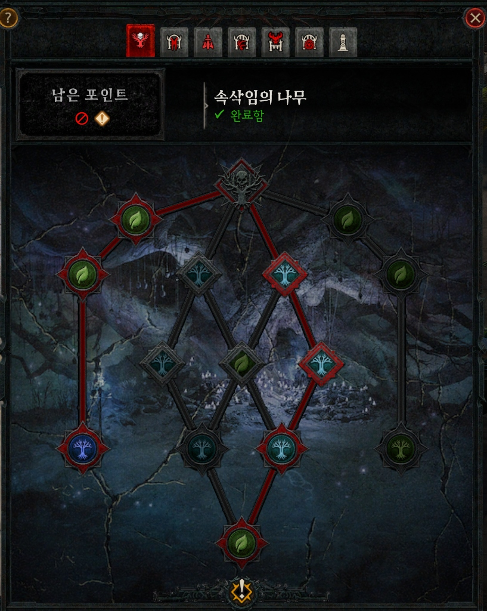
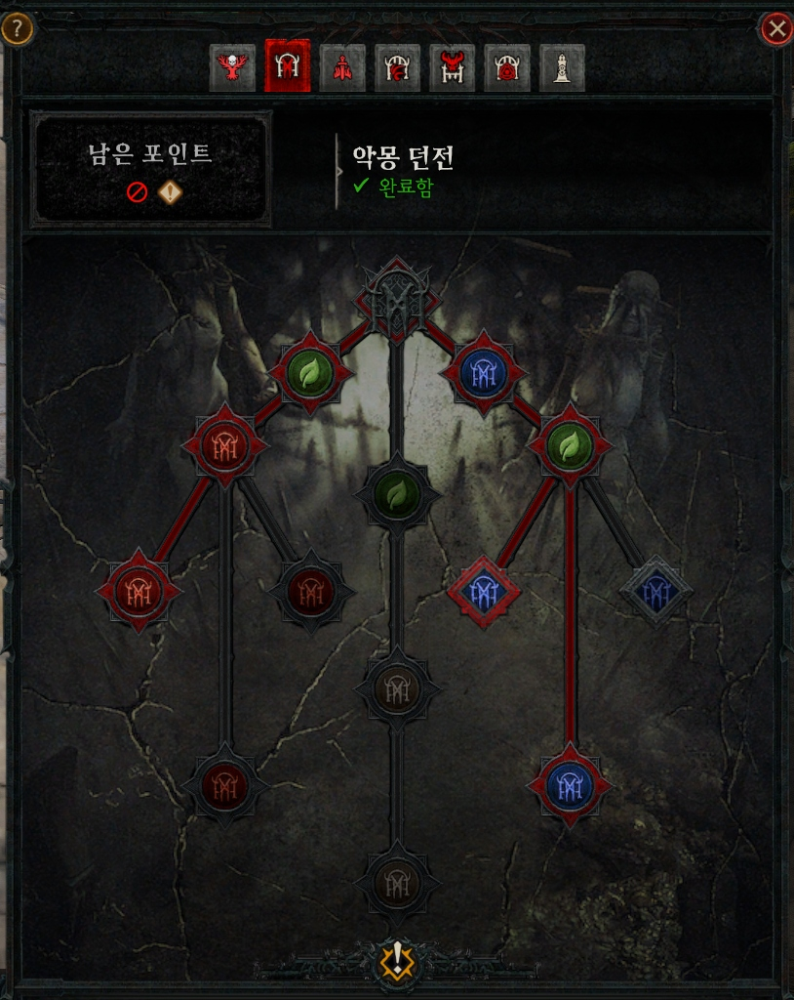
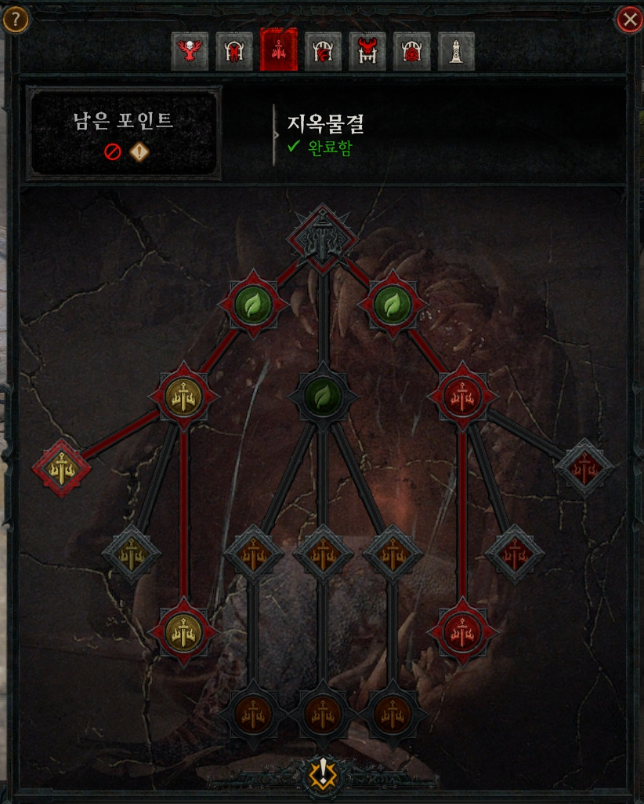
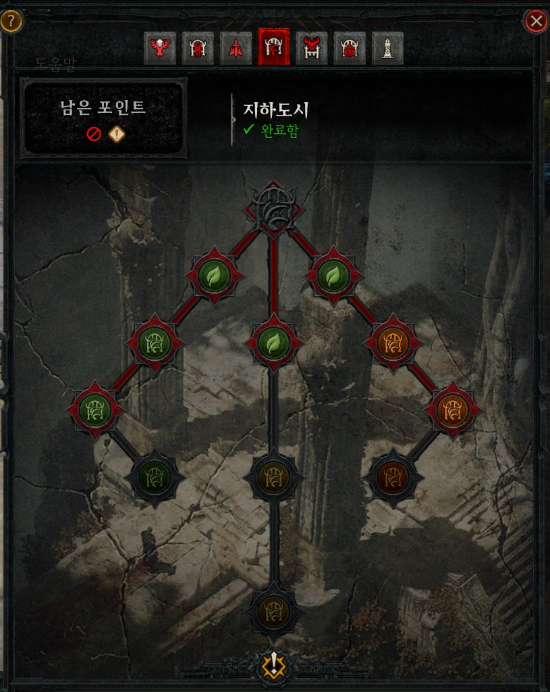
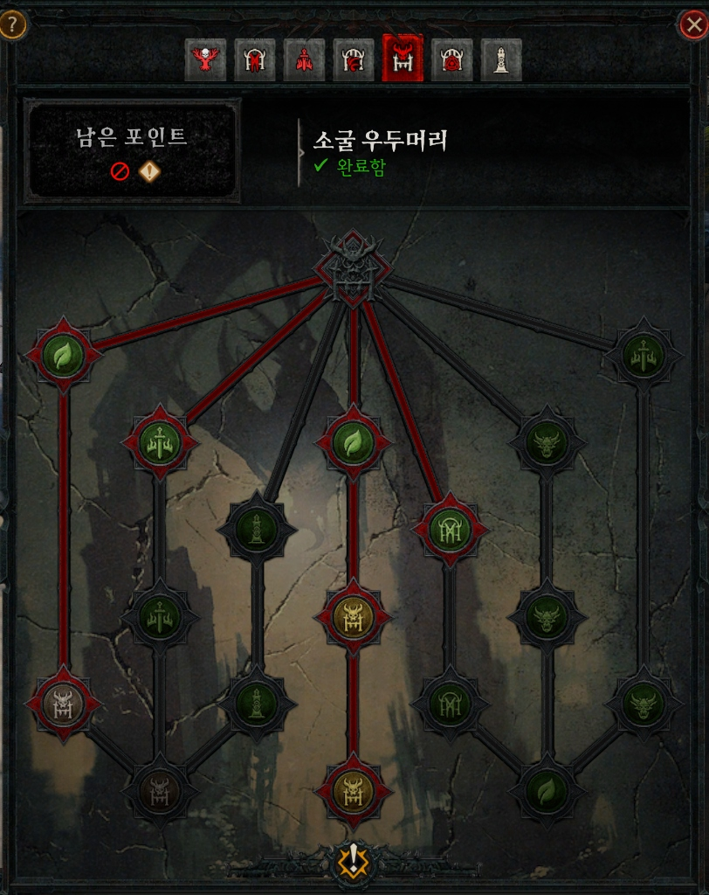
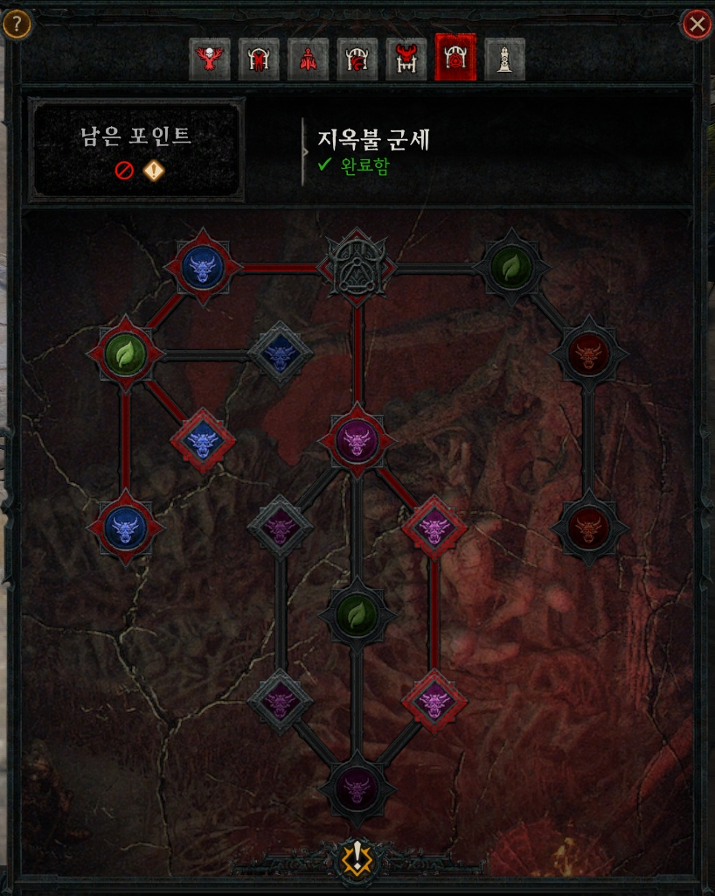
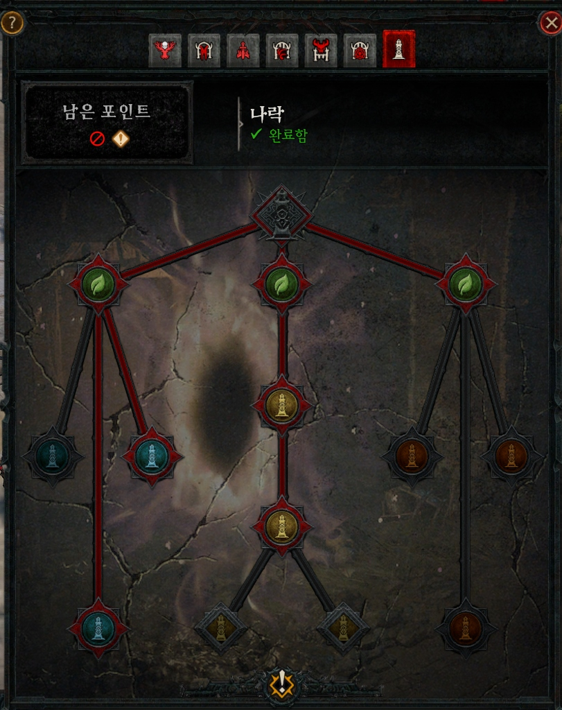
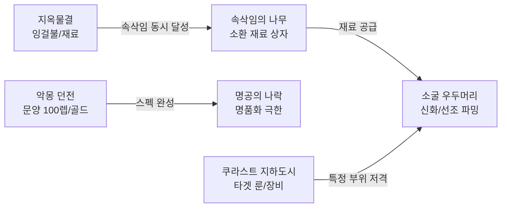

# 디아블로 4 시즌 15 — 전쟁 계획(War Plans) 완벽 가이드

> 최종 갱신: 2026-10-19. 시즌 15 지휘 탁자 시스템 분석 및 엔드게임 노드 최적화 정리.

---

## 0. 전쟁 계획(War Plans)이란?

**전쟁 계획**은 디아블로 4 시즌 15에서 엔드게임 파밍 동선을 극대화하기 위해 도입된 **콘텐츠 특화 성장 트리 시스템**입니다. 스코보스 테미스(Temis)의 티리엘 옆 **전쟁 계획 지휘 탁자**에서 관리할 수 있습니다.

### 핵심 시스템 요약
1. **맞춤형 파밍 플레이리스트**: 플레이어가 원하는 핵심 엔드게임 콘텐츠(지옥물결, 악몽 던전, 속삭임, 지하도시, 보스, 군세, 나락)를 연결하여 순서대로 돌며 특화 보상을 얻습니다.
2. **콘텐츠별 전용 스킬 트리 (노드)**: 7개 핵심 콘텐츠마다 전용 특성 트리가 존재하며, 포인트를 투자해 몬스터 밀도 폭증, 보스 소환 재료 2배, 추가 보물 상자, 고유 드랍률 상승 등의 효과를 부여합니다.
3. **계정 공유 적용**: 한 캐릭터에서 찍어둔 전쟁 계획 트리는 계정 내 모든 캐릭터가 공유하므로 부캐릭터 육성 시 엄청난 시너지를 냅니다.
4. **포인트 제한과 경로 선택**: 포인트가 무제한이 아니므로(트리당 완료 제한), **어떤 루트(좌/중앙/우측)를 선택해 내려가느냐**가 파밍 효율을 결정합니다.

---

## 1. 콘텐츠별 전쟁 계획 트리 상세 분석 & 추천 노드

---

### ① 속삭임의 나무 (Tree of Whispers)

*그림: 속삭임의 나무 전쟁 계획 트리 (실제 게임 화면)*

#### 특징 및 역할
- **패시브 시너지의 핵심**: 지옥물결, 악몽 던전 등을 돌 때 속삭임 퀘스트(섬뜩한 축복)가 자동으로 병행 완료되도록 지원합니다.
- **주요 노드 효과**:
  - **상단 녹색 노드**: 속삭임 완료 시 경험치 및 금화 보상 증가.
  - **중앙/우측 푸른색 나무 노드**: 특정 지역 몬스터 사냥 시 섬뜩한 축복 획득 속도 가속, 속삭임 암습자(추가 정예 몹) 난입 확률 대폭 증가.
  - **하단 특화 노드**: 속삭임 보관함 개봉 시 **소굴 우두머리 소환 재료(피, 강철, 달걀 등)** 및 상급 장비 드랍률 추가.

#### 추천 선택 루트
- **우측 집중 트리 (암습 & 고속 완료)**: 지옥물결과 함께 병행할 때 암습 몬스터가 쏟아져 나와 잉걸불과 축복을 동시에 채우는 필수 세팅입니다.

---

### ② 악몽 던전 (Nightmare Dungeons)

*그림: 악몽 던전 전쟁 계획 트리 (실제 게임 화면)*

#### 특징 및 역할
- **문양(Glyph) 폭풍 레벨업 & 골드 수급**: 문양 100레벨 달성을 위해 던전 내부 클리어 속도와 문양 경험치를 극대화합니다.
- **주요 노드 효과**:
  - **상단/중앙 녹색 노드**: 악몽 던전 완료 시 획득하는 문양 경험치 추가 보너스.
  - **좌측 붉은색 투구 노드**: 정예 몬스터 팩 밀도 증가, 던전 내 성소 지속 시간 및 버프 강화.
  - **우측 파란색 문양 노드**: 보물 고블린 무리 출현율 증가, 던전 클리어 시 추가 인장 및 금화 보상.

#### 추천 선택 루트
- **좌측(정예 밀도) + 우측(문양 경험치) 밸런스 트리**: 중앙의 문양 경험치 보너스를 반드시 확보하고, 좌측 정예 팩을 늘려 사냥 효율과 템 파밍을 동시에 챙깁니다.

---

### ③ 지옥물결 (Helltide)

*그림: 지옥물결 전쟁 계획 트리 (실제 게임 화면)*

#### 특징 및 역할
- **레벨링 & 소환 재료 & 잉걸불의 보고**: 시즌 초반부터 엔드게임까지 가장 많은 시간을 보내는 핵심 필드 콘텐츠입니다.
- **주요 노드 효과**:
  - **상단 녹색 노드**: 지옥물결 내 변형 잉걸불 기본 드랍률 및 이동 속도 증가.
  - **좌측 노란색 검 노드 (상자 특화)**: 수수께끼 상자 및 특정 무기/방어구 상자 개봉 시 추가 아이템 드랍, 상자 개봉에 필요한 잉걸불 할인.
  - **우측 붉은색 검 노드 (전투 & 여제 특화)**: 피의 여제(Blood Maiden) 소환 시 추가 엘리트 난입, 지옥물결 우두머리(지옥살이 등) 출현 빈도 증가.
  - **중앙 하단 갈색 검 노드**: 잉걸불 구더기 및 환경 오브젝트 파괴 시 대량의 잉걸불 폭발.

#### 추천 선택 루트
- **중앙(밀도) + 우측(여제 파밍) 트리**: 여제 제단 앞에서 무한 소환 파밍을 할 때 정예 몹과 잉걸불이 쏟아져 나와 10분 만에 1,000개 이상의 잉걸불을 모을 수 있습니다.

---

### ④ 쿠라스트 지하도시 (Kurast Undercity)

*그림: 쿠라스트 지하도시 전쟁 계획 트리 (실제 게임 화면)*

#### 특징 및 역할
- **타겟 파밍(공물 & 조율)의 극대화**: 원하는 부위(목걸이, 특정 고유 등)를 저격 파밍할 때 제한 시간과 보상 단계를 늘려줍니다.
- **주요 노드 효과**:
  - **중앙 녹색 노드 (시간 & 이동)**: 몬스터 처치 시 추가 획득 시간 증가, 비전 봉화 상호작용 속도 및 보너스 증가.
  - **좌측 녹색 도시 노드 (조율 등급)**: 층별 클리어 시 4등급 조율 보상 달성 난이도 완화, 공물 소모 대비 기본 보상 증폭.
  - **우측 주황색 도시 노드 (정예 & 보스)**: 지하도시 최종 보스 처치 시 추가 룬 및 전설 고유 드랍률 상승.

#### 추천 선택 루트
- **중앙(시간 연장) → 좌측(조율 4등급 보장) 트리**: 시간 부족으로 조율 4등급을 놓치는 사고를 원천 방지하고 확정적으로 최고 등급 전리품 상자를 여는 루트입니다.

---

### ⑤ 소굴 우두머리 (Lair Bosses)

*그림: 소굴 우두머리 전쟁 계획 트리 (실제 게임 화면)*

#### 특징 및 역할
- **신화 고유 & 극옵 선조 고유 저격**: 두리엘, 안다리엘, 그리구아르, 바르샨, 지르, 얼음 속의 야수 등 보스 파밍 효율을 끌어올립니다.
- **주요 노드 효과**:
  - **상단/좌측 녹색 노드**: 보스 소환에 소모되는 재료의 일정 비율 환급(페이백) 기회 제공.
  - **중앙 황금 해골 노드 (대악마 보스 강화)**: 칠흑의 두리엘/안다리엘 처치 시 **신화 고유(보라색) 아이템 드랍 확률 보정** 및 추가 선조 고유 드랍.
  - **우측 악마 노드 (일반 우두머리)**: 하위 보스 처치 시 상위 보스 소환 재료(점액질 달걀, 고통의 파편) 추가 획득.

#### 추천 선택 루트
- **좌측(재료 절감) → 중앙(신화 드랍 테이블 극대화) 트리**: 값비싼 소환 재료를 아끼면서 신화 고유 획득 기대값을 가장 높이는 필수 엔드게임 루트입니다.

---

### ⑥ 지옥불 군세 (Infernal Hordes)

*그림: 지옥불 군세 전쟁 계획 트리 (실제 게임 화면)*

#### 특징 및 역할
- **대량의 골드 & 명품화 재료(마법가루 등) 수급처**: 라운드별 선택지(에테르) 효율을 대폭 증폭시키고 최종 상자 보상을 극대화합니다.
- **주요 노드 효과**:
  - **좌측 푸른색 악마 노드 (에테르 생성 & 증폭)**: 몬스터 처치 시 불타는 에테르 생성 확률 증가, 에테르 군주/덩어리 처치 시 보너스 에테르 획득.
  - **중앙 보라색 악마 노드 (파도 선택지 강화)**: 라운드 종료 시 주어지는 '지옥의 제안'에서 고위험-고보상(에테르 배율 대폭 상승) 선택지 출현율 증가.
  - **우측 붉은색 악마 노드 (최종 상자 보상)**: 60에테르 장비 상자(선조 보장), 골드 상자, 재료 상자의 최종 보상 배율을 영구 증폭.

#### 추천 선택 루트
- **좌측(에테르 증폭) + 중앙(선택지 강화) 트리**: 스크린샷과 같이 좌측의 푸른색 에테르 증폭 라인과 중앙의 보라색 선택지 라인을 타고 내려가, 매 판 700~1,000개 이상의 에테르를 안정적으로 수급하는 세팅입니다.

---

### ⑦ 명공의 나락 (The Pit)

*그림: 명공의 나락 전쟁 계획 트리 (실제 게임 화면)*

#### 특징 및 역할
- **엔드게임 스펙의 한계 시험 & 마스터워크 극한 파밍**: 나락 클리어 시간 단축 및 옵두사이트(명품화 재료) 수급 극대화.
- **주요 노드 효과**:
  - **상단 3개 녹색 노드 (기본 추진력)**: 나락 시작 시 이동 속도 증가, 비약/향 지속 시간 및 기본 생존력 보정.
  - **좌측 청록색 오벨리스크 노드 (게이지 고속 충전)**: 정예 몬스터 처치 시 나락 진척도 게이지 충전량 대폭 증가, 보스 소환까지 걸리는 시간 단축.
  - **중앙 황금 오벨리스크 노드 (명품화 재료 증폭)**: 나락 클리어 시 획득하는 명품화 재료(옵두사이트 등) 수량 배율 대폭 증가.
  - **우측 갈색 오벨리스크 노드 (보스전 안정성)**: 수호자(보스)전 피해 감소 및 부활 페널티 시간 완화.

#### 추천 선택 루트
- **좌측(게이지 충전 가속) + 중앙(명품화 재료 증폭) 트리**: 스크린샷처럼 좌측과 중앙 라인을 함께 활성화하여, 쫄 구간을 1~2분 만에 스킵하고 대량의 명품화 재료를 챙겨 나오는 쾌속 파밍 루트입니다.

---

## 2. 노드 간의 상호 연관성 & 콘텐츠 시너지

전쟁 계획 트리는 각각 따로 노는 것이 아니라, **하나의 유기적인 순환 파밍 루프**를 형성합니다.

1. **지옥물결 ↔ 속삭임의 나무 (최고의 파트너)**
   - 지옥물결의 '몹 밀도 증식 노드'와 속삭임의 '암습자 스폰 노드'가 만나면 사냥터가 몬스터로 가득 차며, 잉걸불과 섬뜩한 축복이 동시에 수급됩니다.
2. **속삭임 ↔ 소굴 우두머리 (소환 재료 파이프라인)**
   - 속삭임 트리의 소환 재료 보너스를 통해 모은 재료를 들고, 소굴 우두머리 트리의 '재료 절감 + 신화 드랍율 노드'로 들어가 극상의 효율을 뽑아냅니다.
3. **악몽 던전 ↔ 명공의 나락 (스펙업 고속도로)**
   - 악몽 던전 트리로 문양을 광속 레벨업한 뒤, 나락 트리로 넘어가 명품화 12강 재료를 쓸어 담습니다.

---

## 3. 상황별 최적의 전쟁 계획 투자법 (추천 가이드)

### 상황 A: "시즌 초반, 1~100레벨 광속 레벨업 구간"
- **우선순위**: **지옥물결(올인) > 속삭임의 나무**
- **추천 루트**:
  - 지옥물결: 상단 이동/잉걸불 획득 → 중앙 몹 밀도 폭증 루트.
  - 속삭임의 나무: 암습 몬스터 추가 스폰 루트.
- **이유**: 필드에서 몹을 잡는 즉시 경험치와 장비가 쏟아져 나와 가장 빠르게 고행 난이도로 진입할 수 있습니다.

### 상황 B: "고행 진입 후, 문양 100레벨 & 기본 빌드 완성 구간"
- **우선순위**: **악몽 던전(올인) > 속삭임의 나무**
- **추천 루트**:
  - 악몽 던전: 문양 경험치 증폭 + 정예 팩 증가 루트.
- **이유**: 고행 난이도에서 문양 레벨이 낮으면 딜이 나오지 않습니다. 문양 경험치 보너스 노드를 찍고 빠르게 주력 문양 5~6개를 전설/100레벨로 만듭니다.

### 상황 C: "엔드게임, 신화 고유(샤코·궤멸자 등) 저격 구간"
- **우선순위**: **소굴 우두머리(올인) > 쿠라스트 지하도시**
- **추천 루트**:
  - 소굴 우두머리: 좌측 재료 절감/환급 → 중앙 칠흑 대악마 신화 드랍 보정 루트.
  - 지하도시: 조율 4등급 보장 루트 (공물 파밍).
- **이유**: 보스 소환 재료의 가치가 매우 높기 때문에 소모를 줄이면서 신화 드랍률을 뻥튀기하는 세팅이 절대적으로 유리합니다.

### 상황 D: "최종 종결, 12강 명품화 & 랭킹/나락 등반 구간"
- **우선순위**: **명공의 나락 > 지옥불 군세**
- **추천 루트**:
  - 명공의 나락: 클리어 보상 명품화 재료 배율 증가 루트.
  - 지옥불 군세: 에테르 골드/재료 상자 극대화 루트.
- **이유**: 명품화 저격 재설정에는 수천만~수억 골드와 엄청난 양의 옵두사이트가 소모되므로 재료 집중형 트리를 탑니다.

---

## 4. 자주 묻는 질문 (FAQ)

**Q. 전쟁 계획 노드를 잘못 찍었는데 다시 바꿀 수 있나요?**
> 네, 언제든지 초기화하여 포인트를 재투자할 수 있으며, 콘텐츠 순서 변경에는 게임 내에서 수급되는 '엘드루인의 징표'가 사용됩니다.

**Q. 모든 콘텐츠 노드를 다 활성화할 수 있나요?**
> 각 트리별로 최상단에서 최하단까지 찍을 수 있는 포인트 한도가 정해져 있습니다. 따라서 한 콘텐츠 내에서도 좌/중앙/우측 중 본인의 플레이 스타일(예: 지옥물결의 경우 상자 까기형 vs 보스 소환형)에 맞춰 한 방향으로 깊게 파고드는 것이 훨씬 강력합니다.
