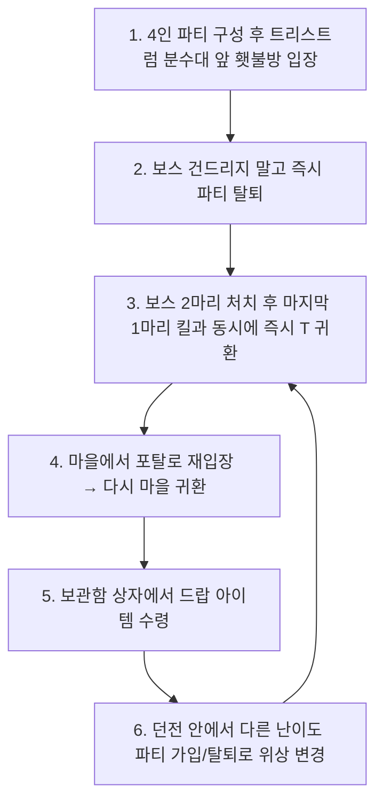

# 파티 무한 횃불런 — 가시 없이도 무한 파밍하는 완벽 가이드

> 최종 갱신: 2026-10-18. 최스타 영상 기반 분석 및 커뮤니티 실측 검증 정리.

*영상: `무한 횃불런`을 언제든지 할 수 있습니다 | 디아블로4 | 최스타 — 썸네일을 누르면 YouTube로 열립니다.*

---

## 0. 핵심 요약 (TL;DR)

- **핵심 원리**: 본인이 직접 대악마의 가시를 모아 포탈을 열지 않아도, **방장(파티장)이 연 횃불방에 파티원으로 입장한 뒤 인스턴스를 분리**하여 파티원도 각자 무한 횃불런을 진행할 수 있습니다.
- **최대 효율**: 1회 포탈 오픈으로 **총 4명(방장 1명 + 파티원 3명)** 전원이 각자 독립적으로 무한 파밍 가능.
- **파티 참여 방법**: 인벤 '파티 찾기' 게시판 등에서 횃불방(약 800억 ~ 1,000억 골드)에 입장권을 구매해 참여하거나, 지인들과 가시를 로테이션으로 오픈하여 진행.
- **기대 보상**: 선조 횃불(다중 어픽스), 선조 고유/신화 아이템, 거짓 선지자의 십자가, 베르 룬 등 대량 획득 가능.

---

## 1. 필수 사전 준비 조건 (매우 중요)

> [!IMPORTANT]
> **방장과 파티원의 '세계 난이도(고행)'는 반드시 달라야 합니다!**

| 구분 | 추천 난이도 설정 | 설명 |
|---|---|---|
| **방장 (포탈 생성자)** | 고행 11 (또는 고행 10 등) | 파티 모집 글에 명시된 방장의 난이도 |
| **파티원 (본인)** | **고행 1 ~ 5** (또는 방장과 다른 고행) | 고행 난이도만 넘기면 드랍 테이블은 동일하므로, 혼자 보스를 빠르게 잡기 위해 **낮은 고행 난이도를 강력 추천**합니다. |

- 방장이 고행 11이라면 파티원은 고행 10, 고행 9, 또는 고행 1~5에 있어야 합니다.
- **같은 난이도에 있으면 파티 탈퇴 시 인스턴스 분리가 정상적으로 이루어지지 않습니다.**

---

## 2. 단계별 상세 진행 순서 (Step-by-Step)

### [1단계] 파티 구성 및 입장
1. 인벤 파티 찾기 등에서 횃불방 파티에 합류합니다 (배틀태그 전달 및 골드 지급).
2. 파티원 4명이 모이면, 방장이 **트리스트럼 분수대 앞**에서 횃불방(트리스트럼 메아리) 포탈을 엽니다.
3. 파티원 전원 포탈을 타고 던전으로 들어갑니다.

### [2단계] 즉시 파티 탈퇴 (인스턴스 독립)
1. 던전에 들어오자마자 **보스를 절대 공격하지 말고, 그 자리에서 즉시 파티를 탈퇴**합니다.
2. 파티를 탈퇴하면 본인이 설정해 둔 원래 세계 난이도(예: 고행 1~5)의 독립된 인스턴스로 자동 전환됩니다.

### [3단계] 보스 처치 및 초고속 T(포탈) 탈출 (★가장 중요한 타이밍)
1. 보스 3마리 중 **2마리를 먼저 처치**하고, **마지막 1마리**만 남겨둡니다.
2. 마지막 보스의 체력을 천천히 깎으면서 키보드의 `T`(마을 귀환) 키를 누를 준비를 합니다.
3. **마지막 보스가 죽는 순간(바닥에 아이템을 뿜어내기 직전, 체력이 0이 되자마자) `T` 키를 연속으로 광클/연타하여 마을로 탈출**합니다.

> [!WARNING]
> **타이밍 실패 주의**: 보스가 죽고 아이템이 바닥에 완전히 떨어진 뒤에 포탈을 타면 버그 메커니즘이 무효화되어 던전이 소멸합니다. 반드시 죽는 즉시 초고속으로 탈출해야 합니다.

### [4단계] 던전 재입장 → 마을 귀환 (보관함으로 아이템 회수)
1. 마을에 도착한 뒤, 방금 열어둔 **포탈을 타고 다시 던전으로 들어갑니다**.
   - 던전에 들어가 보면 보스는 이미 처치되어 비어 있고, 바닥에 아이템이 없습니다.
2. 던전 안에서 **다시 마을로 귀환**합니다 (`T` 키 또는 포탈).
3. 마을의 **보관함(상자)**을 열어보면, 바닥에 떨어졌어야 할 보스 드랍 아이템(선조 횃불, 고유 장비 등)이 **'잃어버린 물품'**으로 상자 안에 가득 들어와 있습니다.
4. 상자의 아이템을 인벤토리로 모두 수령합니다.

### [5단계] 위상 변경(인스턴스 리셋) 후 무한 반복
1. 아이템을 챙긴 뒤, 다시 열려 있는 포탈을 타고 **던전(트리스트럼 메아리) 안으로 들어갑니다**.
2. **위상 변경 진행**:
   - '친구 목록' 또는 '파티 찾기(고급 검색)'를 열어 현재 나와 세계 난이도가 다른 파티에 잠시 참가했다가 **즉시 파티 탈퇴**를 누릅니다.
   - (예: 본인이 고행 10이면 고행 9~1 파티에 들어갔다 즉시 탈퇴)
3. 위상이 변경되면서 던전 내에 **보스 3마리가 즉시 리셋되어 다시 생성**됩니다.
4. 이제 **[3단계] ~ [5단계]를 원하는 만큼 무한히 반복**하시면 됩니다.

---

## 3. 핵심 주의사항 및 실패 방지 팁

| 구분 | 주의사항 | 해결 방법 |
|---|---|---|
| **귀환 타이밍** | 보스가 죽은 후 너무 늦게 T를 누른 경우 | 마지막 보스 체력이 10% 미만일 때부터 T 연타를 준비하고, 피가 다 닳는 순간 즉시 연타합니다. |
| **세계 난이도** | 방장과 같은 난이도로 들어간 경우 | 파티 가입 전 자신의 세계 난이도를 미리 방장과 다른 단계(고행 1~5 추천)로 변경해 둡니다. |
| **위상 변경** | 던전 밖(마을)에서 위상 변경 시도 | 던전 안(트리스트럼 메아리)에 들어가 있는 상태에서 파티 가입/탈퇴로 위상을 변경해야 보스가 정상 리셋됩니다. |
| **보스 처치 속도** | 너무 강력한 광역기로 보스 3마리가 동시 급사 | 단일기로 2마리를 먼저 확실히 점사하여 제거한 뒤 마지막 1마리를 천천히 유도해 잡습니다. |

---

## 4. 파밍 수익화 및 골드 순환 팁

- 무한 횃불런에서 획득하는 **거짓 선지자의 십자가**, **베르 룬**, **유효 상급 어픽스 선조 횃불**은 거래소나 인벤에서 고가에 활발히 거래됩니다.
- 얻은 아이템을 판매해 수천억 골드를 확보하면, 다시 횃불방 입장권(800억~1,000억)을 구매해 무한 동력으로 반복 파밍이 가능합니다.
